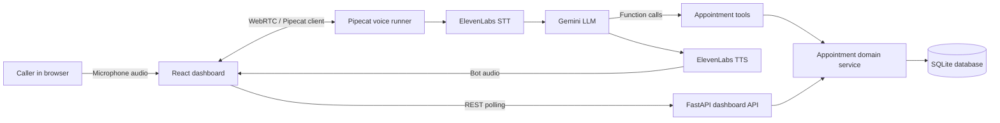
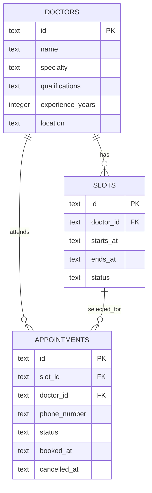
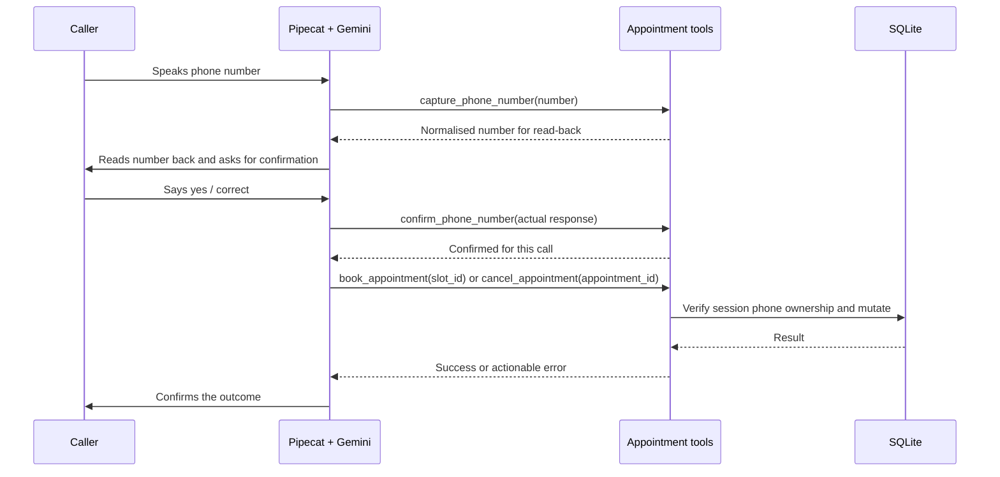

# System architecture

## 1. Design goals

The implementation follows the assignment's required Pipecat, ElevenLabs and React stack. It keeps the demo small enough to run locally while preserving a clear separation between voice interaction, appointment rules, persistence and dashboard reads.

The design has one domain service and one SQLite database shared by the dashboard API process and the Pipecat voice process. The frontend never writes appointment records directly. All booking and cancellation mutations are performed by the voice tools.

## 2. Component architecture



### Frontend

`frontend/` is a Vite React and TypeScript application. It contains:

- Overview metrics and doctor cards.
- Next available slots for each doctor.
- Upcoming and cancelled appointment tables.
- A phone-style call modal with connection state, elapsed time, microphone control, end-call action and live captions.
- Four-second polling of the dashboard API so the table reflects voice-tool mutations without a page reload.

The Pipecat JavaScript SDK and Small WebRTC transport handle browser microphone capture, WebRTC signalling, audio playback and RTVI user-input and bot-output callbacks. The client does not receive provider API keys.

### Dashboard API

`backend/app/api/main.py` exposes read-only REST endpoints. It is intentionally separate from the voice runner because the Pipecat development runner owns its FastAPI signalling service and `/start` session lifecycle.

### Voice runner

`backend/app/voice/bot.py` exposes the Pipecat `bot(runner_args)` entry point. The Pipecat development runner starts the WebRTC session, and each call receives its own in-memory identity state. The pipeline is:

```text
Browser audio
  -> SmallWebRTCTransport input
  -> ElevenLabsRealtimeSTTService
  -> LLMContext user aggregator + Silero VAD
  -> GoogleLLMService (Gemini)
  -> Appointment function tools when required
  -> ElevenLabsTTSService
  -> SmallWebRTCTransport output
  -> Browser audio
```

The Google Gemini LLM receives the tool definitions through `LLMContext`. The appointment functions call the shared domain service; they do not query the dashboard API over HTTP.

### Domain and storage

`backend/app/services/appointments.py` contains the appointment rules. `backend/app/db.py` owns SQLite connection creation, schema initialisation and demo seeding. Both backend processes point at `backend/data/appointments.db` unless `DATABASE_PATH` is overridden.

## 3. Data model



Slots are created independently of appointments. A successful booking inserts an appointment and changes the selected slot to `booked` inside one write transaction. A successful cancellation changes the appointment status to `cancelled` and returns the slot to `available`.

## 4. Appointment tool contracts

| Tool | Inputs | Behaviour |
| --- | --- | --- |
| `check_doctor_availability` | Doctor name, specialty, optional ISO date | Matches doctors, then returns their open slots with stable slot IDs. |
| `capture_phone_number` | Spoken phone number | Normalises the number, clears any previous confirmation and stores it as pending in this call. |
| `confirm_phone_number` | Caller response after read-back | Accepts an explicit affirmative and marks the pending number as verified for this call. |
| `book_appointment` | Exact returned slot ID | Requires a verified phone number, then books an available slot transactionally. |
| `cancel_appointment` | Appointment ID, or empty string when not yet selected | Requires a verified phone number and only cancels an active appointment owned by that number. If several exist, returns choices. |

`capture_phone_number` and `confirm_phone_number` are additional guardrail tools. They make the required number read-back explicit instead of leaving it entirely to a prompt instruction.

## 5. Identity and confirmation sequence



The verified number is held only in the current bot invocation's `session_state`. It is not loaded from browser state, caller ID, a login, OTP or a global variable. A new voice session begins unverified.

## 6. Security and reliability boundaries

- Provider keys are read only by the backend from `backend/.env`.
- Frontend configuration contains endpoint URLs only.
- The dashboard API exposes read endpoints and does not implement unauthenticated mutation endpoints.
- The domain layer normalises phone numbers and validates slot ownership/status.
- Booking is protected by a SQLite write transaction and an availability re-check.
- Cancellation checks both the active appointment and the confirmed phone number.
- The database contains synthetic demo records only. The project is not a production healthcare system and does not implement clinical, regulatory or enterprise authentication controls.

## 7. Runtime ports

| Process | Port | Responsibility |
| --- | ---: | --- |
| Vite | 5173 | Dashboard and phone UI |
| FastAPI | 8000 | Dashboard read API |
| Pipecat runner | 7860 | WebRTC signalling and voice sessions |
